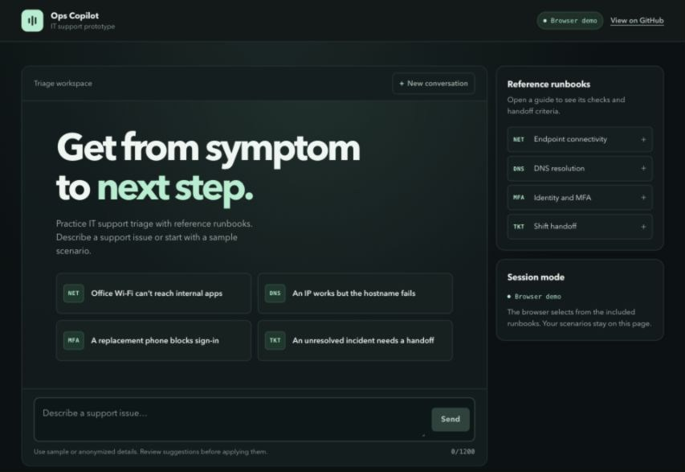

# Ops Copilot

**An IT support assistant with a practice workspace and an optional Gemini backend.**

Ops Copilot helps support teams plan a first pass at diagnosing common incidents. Describe an issue to find a relevant runbook, get a short list of checks, and see what to document before handing the ticket off. The browser demo needs no account or API key.

Created by Ernesto Cardenas to explore how AI can help IT operations teams find relevant guidance and prepare clearer handoffs. [Portfolio](https://justernesto.github.io/my-portfolio-website/) · [LinkedIn](https://www.linkedin.com/in/nescardenas)



## Try a scenario

| Scenario | Example prompt | What to look for |
| --- | --- | --- |
| Network connectivity | “My laptop connects to Wi-Fi, but nothing loads.” | Establish who is affected and isolate the problem to the device, network, or service. |
| DNS troubleshooting | “I can reach a host by IP address, but its hostname fails.” | Check name resolution separately from basic connectivity. |
| MFA and access | “I replaced my phone and can’t complete MFA.” | Confirm the symptom, verify the user through approved channels, and route recovery to the identity team. |
| Ticket handoff | “What should I include in this ticket handoff?” | Capture impact, checks already run, and the next action the receiving team needs to take. |

Use fictional tickets and sample data. The assistant provides guidance that a technician reviews and applies, and cites the runbook used for the reply.

## Runbook library

Use **Reference runbooks** to search by symptom or filter by topic. Each guide includes checks to establish scope, distinguish likely causes, verify recovery, and record evidence for the next owner. The library covers network and VPN issues, identity and access, endpoints and mobile devices, remote desktops, mail and collaboration, file storage and sharing, business applications, security reports, and incident operations.

The [shared catalog](chat-ui/src/lib/runbooks.json) supplies the browser demo, API, and terminal. Specific symptom phrases take priority over broad terms, and explicit handoff requests open the shift handoff guide.

## Run locally

Start the Next.js workspace from the repository root with Node.js 22 or later. The built-in demo runs entirely in the browser.

```sh
cd chat-ui
npm ci
npm run dev
```

Open [http://localhost:3000](http://localhost:3000) and select a sample prompt or describe an issue.

To use the optional FastAPI backend, run these commands with Python 3.11 or later from the repository root in a second terminal.

```sh
python -m venv .venv
source .venv/bin/activate
python -m pip install -r requirements.txt
uvicorn agent_langchain:app --reload
```

Add the following to `chat-ui/.env.local`, restart the frontend, and select **Connect configured API** in the workspace.

```dotenv
NEXT_PUBLIC_OPS_API_URL=http://localhost:8000
```

The API runs in demo mode by default. To try Gemini locally, set `OPS_ENABLE_GEMINI=1` and `GEMINI_API_KEY` in the **backend** environment before starting the API. The default is `gemini-3.5-flash-lite`. Set `GEMINI_MODEL` to use another compatible model. Keep the key outside frontend variables and source control.

You can also run a one-off prompt or start an interactive terminal session from the repository root.

```sh
python agent.py 'My DNS lookup fails but the IP address works.'
python agent.py
```

## How it works

- **Browser demo.** The browser selects from the catalog locally and renders the selected guide’s checks and handoff details.
- **Gemini mode.** For a supported issue, the API sends the current prompt and up to two recent user messages to Gemini to rank the checks from the selected runbook. The backend validates the order and renders the original runbook text. If the provider fails, the backend uses the runbook's default order. Each reply reports the mode used.
- **Conversation scope.** The client sends a bounded recent history for context. Each API request carries its own history, so one visitor’s conversation can’t become part of another visitor’s reply.
- **Review boundary.** The prototype proposes checks and documents decisions. A technician applies any changes using their organization’s tools and procedures.

## API at a glance

| Route | Result |
| --- | --- |
| `GET /` | `{"status":"ok"}` for existing health checks. |
| `GET /health` | Service status and configured mode. |
| `POST /chat` | A reply, response mode, and a list of source runbooks. |

```sh
curl http://localhost:8000/chat \
  -H 'Content-Type: application/json' \
  -d '{"message":"DNS lookup fails but the IP address works","history":[]}'
```

The `message` field accepts up to 1,200 characters. The optional `history` field accepts up to six prior messages. Each item has a `role` of `user` or `assistant` and a `content` string of up to 2,400 characters. Each source includes `id` and `title`. The response reports `mode` as `demo` or `gemini`. [Interactive API docs](http://localhost:8000/docs)

## Hosting

The Next.js app can be deployed with `chat-ui` as the Vercel project root. The browser demo is the initial mode. With the default hosted API, **Connect configured API** sends health and chat requests through the app's own domain, so generated Vercel URLs can use the same backend.

For a custom API, set `NEXT_PUBLIC_OPS_API_URL` to its URL and add the frontend origin to `OPS_ALLOWED_ORIGINS` in that backend's environment. Use a comma to separate multiple allowed origins. Local development allows `localhost:3000` and `127.0.0.1:3000` by default.

Keep Gemini testing on a local bind. The prototype has no user authentication or per-user API quotas.

## Verify locally

```sh
python -m unittest discover -s tests -v
```

The tests run offline and cover grounded demo replies, input validation, conversation isolation, Gemini response validation, and provider fallback. The frontend has a separate build check.

```sh
cd chat-ui
npm run build
```

## Self-host locally with Docker Compose

Ops Copilot supports local self-hosting with Docker Compose.

### Requirements

- Docker Desktop or Docker Engine with Docker Compose
- Git
- An optional Gemini API key for AI-powered prioritization

### Configuration

Clone the repository and create a private environment file at
`../ops-copilot-private/backend.env`, relative to the repository root.

For keyless demo mode, the file needs only:

```dotenv
OPS_ENABLE_GEMINI=0
```

To enable Gemini, set `OPS_ENABLE_GEMINI=1` and add your own
`GEMINI_API_KEY` to that private file. `GEMINI_MODEL` is optional.

Never commit the private environment file or API key.

### Run

From the repository root:

```powershell
docker compose -f compose.local.yaml config --quiet
docker compose -f compose.local.yaml up -d --build
```

Open http://127.0.0.1:3000 and select "Connect configured API".

The FastAPI backend is available at http://127.0.0.1:8000.

### Manage the containers

```powershell
docker compose -f compose.local.yaml ps
docker compose -f compose.local.yaml logs --tail 100
docker compose -f compose.local.yaml stop
docker compose -f compose.local.yaml start
```

Both published ports are bound to the local loopback interface.
No inbound public access is configured.

The containers use the `unless-stopped` restart policy. The host
computer must remain awake with Docker running. On Windows, Docker
Desktop can be configured to start when the user signs in.

Gemini is optional. If Gemini is unavailable or its quota is exhausted,
Ops Copilot falls back to the built-in runbook responses.

This prototype does not include authentication or per-user API quotas.
Do not expose the backend publicly without additional security controls.
